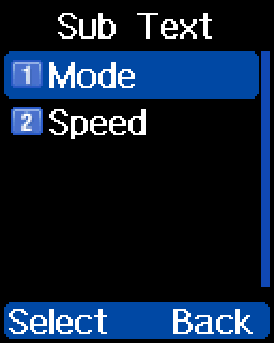
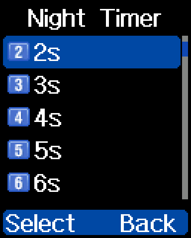

## Sub text

Picks the second line of text under the channel name on the idle
screen: the active zone name, the currently selected talkgroup or
contact, or both, alternating. reFW adds it to the radio's Display
menu, with Bat Icon and Bat Warning from
[Power and battery](power.md):

Sub Text opens a sub-menu with two items, Mode and Speed:

### Mode

What the second line shows. `Both` swaps between the zone name and the
contact at the rate set by [Speed](#speed).

- **Menu:** Settings → Radio Set → Display → Sub Text → Mode
- **Options:** `Zone`, `Contact`, `Both`
- **Default:** `Not yet documented`
- **Storage:** `Not yet documented`

### Speed

How fast `Both` alternates: every 5 seconds at `Slow`, every 2 seconds
at `Fast`.

- **Menu:** Settings → Radio Set → Display → Sub Text → Speed
- **Options:** `Slow`, `Fast`
- **Default:** `Slow`
- **Storage:** reFW settings block `0x02E80000` + `0x10`, bit 3 (`0` =
  Slow, `1` = Fast)

## Night mode

Dims the screen for dark environments without changing the UI color
palette.

- **Menu:** a [key function](keys.md#assigning-functions-to-keys),
  code 61

The Display menu also has a `Night Mode` item (item 2). Whether it is
the same setting as this key function is `Not yet documented`.

### Night mode timer

Sets how long the screen stays bright after a key press while night
mode is on, up to 30 seconds. This reading of the option is
`Unconfirmed`.

- **Menu:** Settings → Radio Set → Display → Night Timer (item 3)
- **Options:** `1s` to `30s`, in 1 s steps
- **Default:** `Not yet documented`. One radio was set to `2s` when
  read on 29 October 2026, build `F7492020`, which may not be the
  factory value
- **Storage:** `Not yet documented`

## Light time

Toggles the backlight between **always on** and your previous backlight
timeout with one key. Useful to keep the display illuminated at a desk,
then switch back to your usual timeout when carrying the radio.

- **Menu:** a [key function](keys.md#assigning-functions-to-keys),
  code 62

The Display menu also has a `Light Time` item (item 4). Whether it is
the same setting as this key function is `Not yet documented`.

## Other display changes

> [!NOTE]
> The first six items come from the changelog for build
> `REFW-20260919-155710`; the rest come from the reFW developer in
> October 2026. Their exact behavior has **not yet been documented**
> from a radio.

- **Bandwidth icon** on analog channels.
- **G icon** when an RX group is selected.
- **New icon** for scrambled/encrypted channels.
- **Promiscuous icon** reflects the setting of the current VFO only.
- **Satellite pass list** doesn't show seconds.
- **Talker Alias** handling was rewritten. Incoming aliases use a
  limited set of UTF-8 characters, with no random Chinese or garbage
  characters. There is no emoji, and many accented letters are missing
  from the font: each shows as `?` ("Loïc" shows as "Lo?c").
  Unsupported symbols show as `???`.
- **New icons** for [Slot Suit](slot-suit.md) and [TX
  idle](calls.md#tx-idle).
- **Cyan** means a hold is active.
- **`DIG` indicator** turns red while a hold is active.
- **Time slot** shows in red during a hold on a manually dialled call.
  The T1/T2 indicator doesn't change for Slot Suit or TX Idle yet.
- **Red channel indicator** during an [exclusive
  hold](calls.md#exclusive-hold).
- **Active VFO marker** in dual-VFO mode, showing which frequency will
  transmit. It is always on; there is no setting for it.
