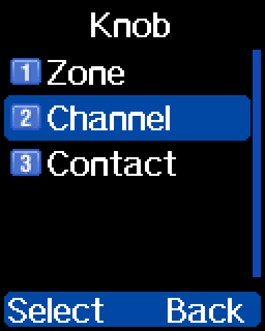
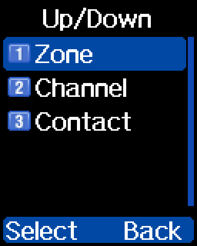

## Assigning functions to keys

reFW adds new functions to the list you can assign to a programmable
key (see [Shortcut functions](shortcuts.md) for all of them). You set
them up the same way as stock ones: **Settings → Radio Set → Keys**,
pick the key (PF1, PF2, …) and the press length, then pick the
function.

Number-key long presses and the `#` key can hold a function too (see
[Number-key and # shortcuts](#number-key-and--shortcuts)), which helps
if the side buttons are already in use.

## Number-key and # shortcuts

Long-pressing any **number key (0–9)** and short-pressing the **`#`
key** can each run a function you assign. They are always available;
there is no setting to turn them on.

- **Menu:** Settings → Radio Set → Keys → Hash Short, and `0 Long` …
  `9 Long` (items 8 to 18)
- **Options:** any [key function](shortcuts.md)
- **Default:** `0 Long` is Dial (code `16`); the rest are OFF (code
  `0`)
- **Storage:** reFW settings block `0x02E80000` + `0x40` for Hash
  Short, then `0x41` … `0x4A` for `0 Long` … `9 Long`. Each byte is a
  key-function code; see
  [settings-storage.md](settings-storage.md#key-functions) for the
  codes.

The `#` key has no stock function left in reFW: its short press only
runs the shortcut you assign to Hash Short. There is no long press on
`#`.

## PF beep

Controls the confirmation beep from **Long Press 1**. The radio's
programmable keys support a long press that normally beeps when it
triggers; this setting can silence it.

- **Menu:** Settings → Radio Set → Audio → PF Beep (item 18)
- **Options:** `Silent`, `Beep`
- **Default:** `Not yet documented`
- **Storage:** `Not yet documented`

## Knob select

Picks what the top rotary knob and the up/down keys step through on
the idle screen. Each one is set on its own, and both can step through
the same thing: for example, the up/down keys for channels and the
knob for talkgroups.

- **Menu:** Settings → Radio Set → Keys → Knob, and Settings → Radio
  Set → Keys → Up/Down (items 19 and 20, the last two in the Keys menu)
- **Options:** `Zone`, `Channel`, `Contact`
- **Default:** `Not yet documented`
- **Storage:** `Not yet documented`

Contact steps only through the talkgroups in the channel's
[RX group](calls.md#rx-groups). On a channel with no RX group it does
nothing. When you change channel or VFO, the contact goes back to the
channel's own contact.

Scanning and WFM take over the knob while they run, and the knob does
nothing on the call screen.

## PTT lock

When the keypad is locked, PTT is locked too. There is no setting for
this.

## Menu navigation and entry

In menus and lists, **PF1** is page up and **PF2** is page down: each
press moves a whole screen, 5 items, instead of one line.
This works in long lists such as Chan Set and the Keys menu.

In a list of option values, typing a value on the keypad jumps straight
to that option.

> [!NOTE]
> The rest of this section comes from the changelog for build
> `REFW-20260919-155710`. Its exact behavior has **not yet been
> documented** from a radio.

- **DCS codes can be typed in directly** instead of scrolled to.

PF1 is also handled better when backing out of editors and when
scrolling up while already at the top of a list.
