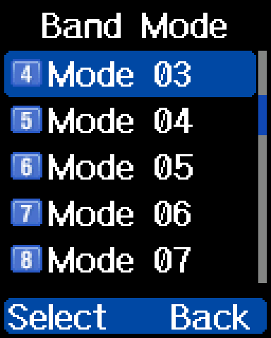

## Scan range

Sets the frequency limits for VFO scanning: a start and end frequency
for **VHF**, and another pair for **UHF**. A VFO scan stays within the
limits for the band you're on.

Frequencies are keyed in directly in MHz, with five decimal places (for
example `136.00000`).

| Item | Default | Storage |
| --- | --- | --- |
| `VHF Start` | `136.00000` | `general_settings` + `0x60` |
| `VHF End` | `174.00000` | `general_settings` + `0x64` |
| `UHF Start` | `460.00000` | `general_settings` + `0x58` |
| `UHF End` | `480.00000` | `general_settings` + `0x5C` |

This adds no storage of its own: the four limits are the stock CPS-only
VFO scan range fields.

- **Menu:** Settings → Radio Set → Misc → Scan Range (item 28), a
  sub-menu with the four items above
- **Storage:** 4 bytes each, a little-endian u32 in units of 10 Hz.
  Checked on a radio running `REFW-20260919-155710` on 2026-09-21:
  VHF Start 136.00000 → 144.12345 MHz changed `0x60`–`0x63` from
  `00 85 CF 00` to `39 EA DB 00` and nothing else. The other three read
  back as the values the menu showed.
- **Validation:** `Not yet documented` (behavior when Start is above
  End, or outside the radio's band mode, is not tested).

## Band mode

Lets you change the radio's operating frequency bands directly from the
menu, skipping the power-on button combination needed to reach the
factory engineering menu. The list offers 18 options: **Mode 00**
through **Mode 17**. The list opens on the radio's current mode. Its
item numbers run one ahead of the mode numbers: item 1 is Mode 00, so
typing `4` highlights Mode 03.

- **Menu:** Settings → Extra → Band Mode (item 1)
- **Options:** `Mode 00` … `Mode 17`
- **Default:** Whatever mode your radio was provisioned with from the
  factory
- **Storage:** *Not stored in the codeplug!* This lives in byte `+3` of
  the flash device-info block at address `0x02FA0000` (making its
  physical address `0x02FA0003`).

Stock forces Band 0 and wipes the codeplug when Band is 14 and the
model name doesn't start with `168#`. reFW removes this, so Mode 14
behaves like any other band mode (see
[Bug fixes](bug-fixes.md)).

### Frequency limits per mode

Each mode sets separate receive and transmit limits for each band. All
frequencies are in MHz.

| Mode | VHF RX | VHF TX | UHF RX | UHF TX |
| --- | --- | --- | --- | --- |
| 00 | 136–174 | 136–174 | 400–480 | 400–480 |
| 01 | 136–174 | 136–174 | 400–480 | 400–480 |
| 02 | 136–174 | 136–174 | 430–440 | 430–440 |
| 03 | 136–174 | 144–146 | 400–480 | 430–440 |
| 04 | 136–174 | 136–174 | 440–480 | 440–480 |
| 05 | 144–146 | 144–146 | 440–480 | 440–480 |
| 06 | 136–174 | 136–174 | 446–447 | 446–447 |
| 07 | 136–174 | 144–148 | 400–480 | 420–450 |
| 08 | 136–174 | 136–174 | 400–470 | 400–470 |
| 09 | 144–146 | 144–146 | 430–432 | 430–432 |
| 10 | 136–174 | 144–148 | 400–480 | 430–450 |
| 11 | 136–174 | 136–174 | 400–520 | 400–520 |
| 12 | 136–174 | 136–174 | 400–490 | 400–490 |
| 13 | 136–174 | 136–174 | 400–480 | 403–470 |
| 14 | 136–174 | 136–174 | 400–520 | 400–520 |
| 15 | 136–174 | 138–174 | 400–480 | 406–470 |
| 16 | 144–147 | 144–147 | 430–440 | 430–440 |
| 17 | 136–174 | 136–174 | 430–440 | 430–440 |

Mode 00 and Mode 01 have the same limits. Mode 01 is reported to allow
narrowband channels only (`Unconfirmed`). Mode 11 and Mode 14 also have
the same limits.

> [!CAUTION]
> On stock firmware, Mode 14 wipes your codeplug (see above). Only
> select it on a radio running reFW.

> [!WARNING]
> The device-info sector stores radio calibration and identity data. The
> firmware maintains an A/B mirror bank at `0x02FC0000` and validates
> bank headers on boot. Tooling authors should treat this byte as
> **read-only** unless their software implements the dual-bank checksum
> and rotation logic. Both `at168-cps` (work in progress) and
> `at168-flasher` guard this data; always back up `device-info` before
> experimenting with band modes.
