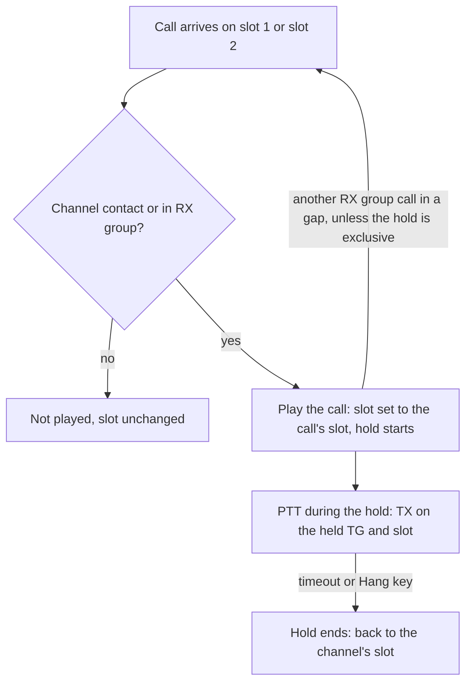
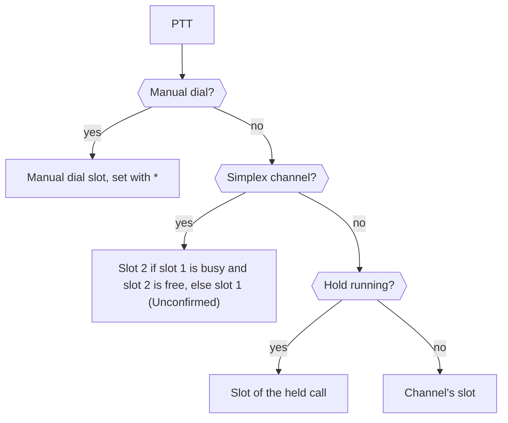

Smart time slot management for a channel. While it is on, the radio
monitors both **slot 1** and **slot 2** on a DMR channel, without
needing [promiscuous mode](channels.md#per-channel-promiscuous), and
manages the time slot itself: you can't pick or swap the slot directly.

## Which calls play

A call on either slot plays when its talkgroup is the channel's contact
or is in the channel's [RX group](calls.md#rx-groups). In practice,
Slot Suit needs an RX group of the talkgroups you want to hear on that
repeater. For example, on a repeater with TG 23551 on slot 1 and TG 2355
on slot 2, one channel on slot 2 with both TGs in its RX group hears
both, and replies to each on its own slot.

## Which slot it uses

While Slot Suit is on, each incoming call sets the time slot the radio
uses to the slot that call arrived on, overriding the channel's
programmed slot. It stays on that slot until a call arrives on the
other one, or you make a call. When no call has set it, the radio uses
the channel's slot.

With two RX group talkgroups active on different slots, the display
alternates between them. Each call that arrives in a gap takes over the
[hold](calls.md#hold-times), unless the hold is
[exclusive](calls.md#exclusive-hold).

Making a call clears it back to the channel's slot. The [hold
time](calls.md#hold-times) keeps its own record of the slot, though, so
calls you make while the hold is running still go out on the slot of
the call you heard. Once the hold expires, or you
[end it](calls.md#ending-a-hold), the channel's slot applies again. A
manual dial goes out on the manual dial slot (`*` on the manual dial
screen), not the Slot Suit slot.

When you press PTT, the radio picks the slot like this:

Replying on the held slot was checked through a repeater on 2026-10-28
with `REFW-20261028-111541`: a call on slot 1 was answered on slot 1,
seen on the repeater dashboard, with the channel set to slot 2.

> [!NOTE]
> During a hold, the main screen still shows the channel's slot, not
> the slot Slot Suit will transmit on. See [Other display
> changes](display.md#other-display-changes).

## When it is in effect

The channel setting is not the only thing that turns it on or off:

| Channel state | Slot Suit |
| --- | --- |
| Promiscuous `Single Slot` | Off, whatever the channel setting |
| Promiscuous `Double Slot` | On, whatever the channel setting |
| Repeater (split frequency) channel with [TX idle](calls.md#tx-idle) on | On, whatever the channel setting |
| DCDM on a simplex channel | On, whatever the channel setting |
| Otherwise | The channel's Slot Suit setting |

This comes from the developer reading the stock firmware's code, and
has not been checked on a radio. Using Slot Suit together with
promiscuous is not recommended: promiscuous is for listening, not for
choosing where to transmit.

## Simplex channels

Replies follow the held slot on repeater channels only. On a simplex
channel the stock rule applies: the call goes out on slot 2 if slot 1
is busy and slot 2 is free, otherwise on slot 1 (`Unconfirmed`).

What happens when the slot a reply should use is busy is `Not yet
documented`.

## Setting it

Slot Suit is a stock AnyTone function, not a reFW addition. Factory
firmware has it (the V1.05 image contains the label) but only enables it
on Chinese-market models. reFW unlocks it on the others too.

- **Menu:** Settings → Chan Set → Slot Suit (item 27), or toggle it
  with the Slot Suit [key
  function](keys.md#assigning-functions-to-keys), code 58
- **Options:** `Not yet documented`
- **Default:** `Not yet documented`
- **Storage:** `Not yet documented`, including whether the key function
  changes the channel's stored setting
